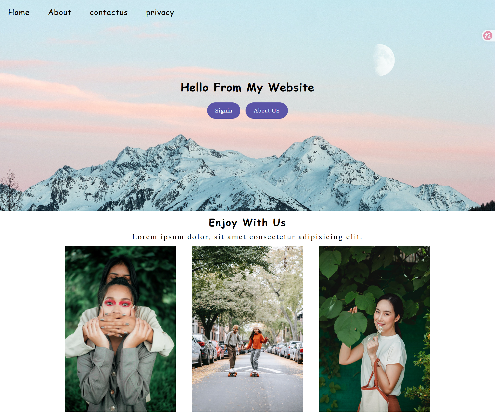

# Task Session 8 – Landing Page

## Project Preview



## Overview

A simple landing page built with **HTML5** and **CSS3** as part of my Front-End Development training at **Creativa**.

The project focuses on creating a structured webpage with a navigation bar, hero section, introductory content, and an image gallery.

## Technologies Used

- HTML5
- CSS3

## Project Sections

### 1. Header Section
- Navigation bar with Home, About, Contact Us, and Privacy links.
- Background image.
- Welcome heading.
- Call-to-action links (Sign In and About Us).

### 2. Main Section
- Introductory heading and description.
- Image gallery containing three images.

## CSS Concepts Applied

- CSS Reset.
- Background Images and Background Size.
- Font Family and Typography.
- Text Alignment.
- Padding and Margin.
- Colors and Border Radius.
- Inline-Block Display.
- CSS Selectors.
- Width and Height Properties.

## Project Structure

```text
task_session_8/
│
├── index.html
│
├── css/
│   └── style.css
│
├── media/
│   ├── 66.jpg
│   ├── 1.jpeg
│   ├── 2.jpeg
│   └── 3.jpeg
│
└── screenshots/
    └── preview.png
```

## Source Code

- [HTML File](index.html)
- [CSS File](css/style.css)

## How to Run

1. Clone or download this repository.
2. Open the project folder.
3. Open `index.html` in your browser.

## Learning Outcomes

- Practicing semantic HTML structure.
- Understanding CSS styling and selectors.
- Working with background images.
- Applying spacing and typography.
- Organizing project files and folders.

---

**Part of my Front-End Development learning journey at Creativa.**
